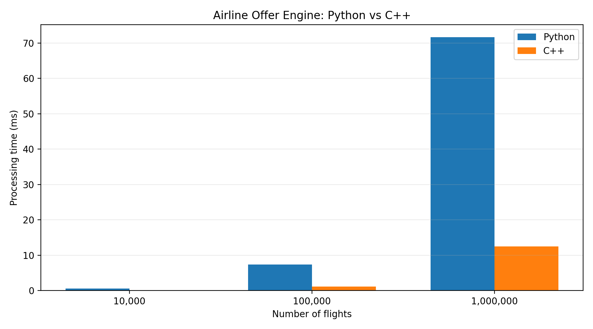
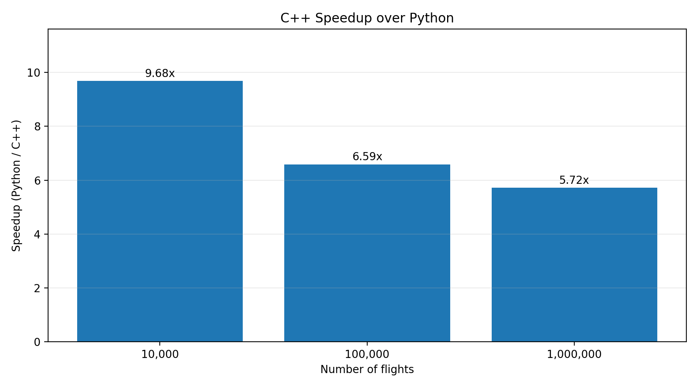

# Airline Offer Engine Benchmark

**A reproducible C++17 vs Python performance comparison for airline offer processing.**

This project implements an airline offer processing engine in C++17 and Python, using identical flight datasets and business rules to compare execution performance while verifying output correctness.

The engine simulates a simplified airline shopping workflow: filtering flights by route, calculating final ticket prices, and sorting available offers.

## Overview

Airline reservation and retailing systems often need to process large volumes of flight data efficiently. This project explores how two implementations of the same processing workflow perform under increasing dataset sizes.

The benchmark focuses on three operations:

1. **Route filtering:** Select flights matching a requested origin and destination.
2. **Offer pricing:** Apply a 15% tax and a fixed service fee.
3. **Offer sorting:** Order matching flights by total price, using the flight number as a secondary sorting key.

The project emphasizes reproducibility, consistent business logic, automated correctness validation, and transparent performance measurements.

## Technologies

| Component | Technology |
|---|---|
| High-performance implementation | C++17 |
| Reference implementation | Python 3 |
| C++ compiler | Microsoft Visual C++ (MSVC) |
| Data format | CSV |
| Data generation | Python |
| Benchmark automation | Python |
| Result validation | CSV comparison and SHA-256 |
| Data visualization | Matplotlib |
| Development environment | Visual Studio Code / Windows |

## Project Structure

```text
airline-offer-engine-benchmark/
├── cpp/
│   ├── main.cpp
│   └── benchmark.cpp
├── python/
│   ├── main.py
│   ├── generate_data.py
│   ├── benchmark.py
│   ├── validate.py
│   ├── run_benchmarks.py
│   └── plot_results.py
├── data/
│   └── (generated CSV files)
├── charts/
│   ├── processing_time.png
│   └── speedup.png
├── .gitignore
└── README.md
```

Generated datasets, benchmark outputs, and compiled binaries are excluded from version control.

## Processing Workflow

```text
CSV Flight Dataset
        |
        v
   Load Flights
        |
        v
 Filter by Route
   BOG -> MIA
        |
        v
 Calculate Prices
        |
        v
 Sort Airline Offers
        |
        v
 Export Results
        |
        v
 Validate C++ vs Python
```

Both implementations process the same input data and use equivalent pricing and sorting rules.

## Pricing Model

The final offer price is calculated using the following formula:

```text
Total Price = Base Fare + Tax + Service Fee
```

The pricing rules are:

- Tax rate: 15%
- Service fee: USD 20.00
- Monetary calculations: integer cents
- Tax rounding: nearest cent for nonnegative amounts, with half-cent values rounded upward

The use of integer cents avoids floating-point inconsistencies in monetary calculations.

For a base fare of USD 100.00:

```text
Base Fare:   USD 100.00
Tax (15%):   USD  15.00
Service Fee: USD  20.00
-----------------------
Total Price: USD 135.00
```

## Benchmark Methodology

Three dataset sizes are evaluated:

- 10,000 flights
- 100,000 flights
- 1,000,000 flights

Flight data is generated with a fixed random seed (`42`) to support reproducibility.

For each dataset size:

1. Generate the CSV dataset.
2. Execute both implementations using the same input.
3. Perform a warm-up run before timing.
4. Measure 10 processing repetitions within each program.
5. Repeat the benchmark across 5 independent process sessions.
6. Alternate the execution order between Python and C++.
7. Validate the complete output from both implementations.
8. Report the median of the 5 session medians.

**Timing scope:** The measurements include route filtering, price calculation, and sorting. CSV input loading, result export, and validation are excluded from the timed section.

The C++ implementation is compiled with optimization enabled (`/O2`).

## Benchmark Results

The following measurements were obtained on a Windows development machine using MSVC for C++17 and Python 3.11.

| Flights | Python (ms) | C++ (ms) | C++ Speedup |
|---:|---:|---:|---:|
| 10,000 | 0.5635 | 0.0582 | 9.68x |
| 100,000 | 7.3917 | 1.1220 | 6.59x |
| 1,000,000 | 71.6215 | 12.5204 | 5.72x |

Speedup is calculated as:

```text
Speedup = Python Processing Time / C++ Processing Time
```

### Processing Time Comparison



### C++ Speedup



### Observations

- C++ achieved lower processing times across all three evaluated dataset sizes.
- The observed speedup ranged from 5.72x to 9.68x in the consolidated measurements.
- Execution times varied between sessions, demonstrating the importance of repeated measurements.
- These results describe this specific implementation, workload, and test environment; they are not universal performance guarantees.

## Correctness Validation

Performance improvements are meaningful only when both implementations produce equivalent results.

The validation process compares the complete sorted offer lists generated by Python and C++, including:

- Flight numbers
- Final prices in integer cents
- Number of matching offers
- Output ordering

The validation script also calculates SHA-256 hashes of both result files to check byte-level identity.

All benchmark scenarios passed output validation.

Example:

```text
=== AIRLINE OFFER VALIDATION ===
Python offers: 17950
C++ offers: 17950
SHA-256: IDENTICAL
VALIDATION PASSED: All offers match
```

The example above corresponds to the one-million-flight dataset.

## How to Run

### Requirements

- Python 3
- A C++17-compatible compiler
- Matplotlib (for chart generation)

The commands below assume **Windows PowerShell** and the Microsoft Visual C++ compiler.

### 1. Compile the C++ Benchmark

Open a terminal with the MSVC build environment configured and run:

```powershell
cl /EHsc /std:c++17 /W4 /O2 .\cpp\benchmark.cpp /Fe:benchmark-cpp.exe
```

### 2. Install the Visualization Dependency

```powershell
python -m pip install matplotlib
```

### 3. Run the Complete Benchmark

```powershell
python .\python\run_benchmarks.py
```

This command automatically generates the datasets, executes both implementations, validates their outputs, and writes the benchmark summary to:

```text
data/benchmark_results.csv
```

### 4. Generate the Charts

```powershell
python .\python\plot_results.py
```

The generated charts are saved to:

```text
charts/processing_time.png
charts/speedup.png
```

### 5. Run an Individual Dataset

To generate 100,000 flights:

```powershell
python .\python\generate_data.py --flights 100000
```

Run Python:

```powershell
python .\python\benchmark.py
```

Run C++:

```powershell
.\benchmark-cpp.exe
```

Validate both outputs:

```powershell
python .\python\validate.py
```

## Computational Complexity

Let:

- **N** = total number of flights in the dataset
- **M** = number of flights matching the selected route

The principal operations have the following complexity:

| Operation | Time Complexity |
|---|---|
| Route filtering | O(N) |
| Price calculation for matching flights | O(M) |
| Sorting matching offers | O(M log M) |

Overall processing time complexity:

**O(N + M log M)**

Both implementations use the same general algorithmic approach, allowing the benchmark to focus on implementation-level performance differences.

## Limitations

This is an educational performance engineering project, not a production airline pricing system.

Current limitations include:

- Synthetic flight data rather than real airline inventory.
- A simplified pricing model without dynamic fares, availability, fare families, or ancillary services.
- A single predefined route (`BOG` to `MIA`).
- Benchmarks conducted on one Windows development environment.
- No comprehensive memory usage or end-to-end CSV loading performance comparison.
- Limited statistical analysis beyond repeated-session medians.

Results may vary with hardware, compiler version, operating system, interpreter version, and background system activity.

## Future Improvements

Potential extensions include:

- Command-line configuration of origin and destination.
- Automated performance regression tests.
- Memory consumption analysis.
- Cross-platform builds using CMake.
- More comprehensive benchmark statistics and raw measurement exports.
- Larger datasets and additional airline shopping scenarios.

## Author

**Kevin Andres Castaneda Acevedo**

Aeronautical Engineer | C++ and Python Software Development | Aviation Technology

[GitHub Profile](https://github.com/TkevinLevin24)

## License

No license has been selected yet. A license file can be added before public release.